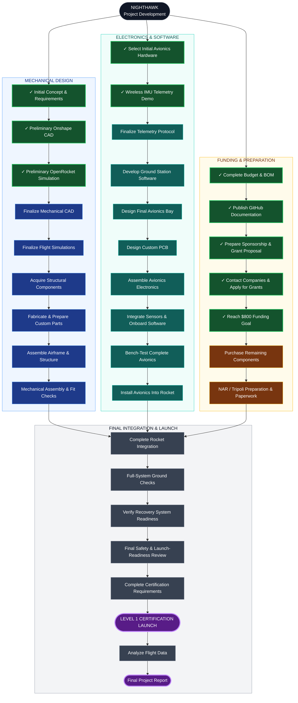

# Nighthawk — Development Roadmap

This roadmap outlines the development of Nighthawk, from its initial concept through Level 1 certification and final documentation.

The project is divided into three parallel development tracks that converge during final integration and testing.

## Project Targets

| Milestone | Target |
|---|---|
| Preliminary Design & IMU Demo | Completed |
| Funding Goal ($800) | December 2026 |
| Final Assembly & Testing | Spring 2027 |
| Level 1 Certification Launch | Spring 2027 |
| Flight Analysis & Final Report | Following Launch |

**Status:** Development and fundraising in progress.

*Last updated: November 3, 2026*
  
